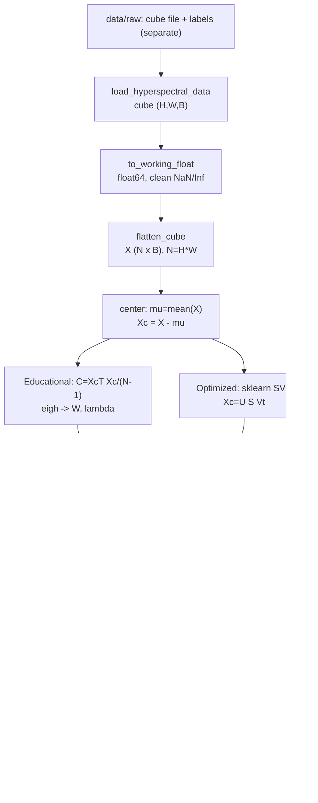

# PCA-Based Hyperspectral Image Compression

**Hyperspectral PCA Lab** — load a hyperspectral cube (default: Indian Pines), run spectral PCA,
inspect principal components, reconstruct the cube, and quantify the compression-vs-quality
trade-off. All numbers are computed from the loaded dataset; nothing is hard-coded.
repo link : https://github.com/farhadakhtar/PCA-Hyperspectral-Image-Compression

> Previous version of this file is preserved as [`OLD_README.md`](OLD_README.md).

---

## Table of Contents

1. [What This Project Does](#1-what-this-project-does)
2. [Dataset](#2-dataset)
3. [Complete PCA Mathematics](#3-complete-pca-mathematics)
4. [Quality & Compression Metrics Formulas](#4-quality--compression-metrics-formulas)
5. [Data-Flow Chart](#5-data-flow-chart)
6. [Repository Structure](#6-repository-structure)
7. [Installation](#7-installation)
8. [Dataset Setup](#8-dataset-setup)
9. [How to Launch & Operate](#9-how-to-launch--operate)
10. [Measured Results (Indian Pines)](#10-measured-results-indian-pines)
11. [Outputs](#11-outputs)
12. [Troubleshooting & Edge Cases](#12-troubleshooting--edge-cases)
13. [Limitations & Future Work](#13-limitations--future-work)
14. [References](#14-references)

---

## 1. What This Project Does

1. **Load** a hyperspectral cube `(H, W, B)` from `.npy` / `.npz` / `.mat` / `.tif` / ENVI `.hdr`,
   keeping ground-truth labels separate (never used for PCA).
2. **Preprocess**: cast to float, clean non-finite values, flatten to a pixel-by-band matrix.
3. **Fit PCA** in one of two mathematically-equivalent modes:
   - `educational`: explicit covariance + `eigh` (transparent, for learning),
   - `optimized`: sklearn SVD-based PCA (better conditioned, for robustness).
4. **Compress** by keeping only `K < B` components: `Z (N x K)`.
5. **Reconstruct** an approximation of the full cube: `X_hat -> (H, W, B)`.
6. **Evaluate** with explained variance, MSE / MAE / MaxErr, PSNR (explicit MAX), SAM,
   per-band curves, and a real on-disk storage audit.
7. **Interact** via Streamlit GUI (10 pages), CLI (`src/pca_compression.py`), or Jupyter notebook.
8. **Export** a real `.npz` compressed package (`Z + Wk + mu`, zlib) plus metrics JSON and figures.

Core identity used everywhere in code:

```text
cube (H x W x B) -> X (N x B) -> mu, Xc = X - mu -> C = Xc^T Xc / (N-1) [B x B]
-> C v = lambda v (eigh, sorted) -> Z = Xc Wk (N x K) -> X_hat = Z Wk^T + mu -> (H x W x B)
-> EVR / MSE / PSNR (explicit MAX) / SAM + storage audit
```

---

## 2. Dataset

Default scene (detected dynamically, not hard-coded):

| Property | Value |
|---|---|
| Source | `data/raw/indianpinearray.npy` (+ `IPgt.npy` labels kept separate) |
| Shape | **145 x 145 x 200** (`H x W x B`, corrected Indian Pines) |
| dtype | uint16, range 955–9604 |
| Pixels | `N = 145 x 145 = 21,025` |
| Values | `N x B = 4,205,000` (~8.41 MB array, ~8.02 MB on disk) |
| Labels | 145 x 145 uint8, classes 0–16 (0 = background) |

Sensor context: AVIRIS originally captures 224 bands (0.4–2.5 µm). The corrected release
drops water-absorption bands [104–108], [150–163] and 220, leaving **200 bands**.

You can substitute any other scene (Pavia University, Salinas, your own `.npy` cube):
just point `--input` / the GUI loader at that file or folder. See [Dataset Setup](#8-dataset-setup).

---

## 3. Complete PCA Mathematics

Notation: `H` = height, `W` = width, `B` = bands, `N = H*W` = pixels,
`K` = retained components (`1 <= K <= B`).

All vectors are row-pixels; implementation lives in
`src/preprocessing.py`, `src/pca_engine.py`, `src/reconstruction.py`.

### Step 0 — Reshape the cube to a data matrix

```text
cube (H, W, B) --C-order reshape--> X in R^(N x B),  N = H * W
```

Each row `x_i (1 x B)` is one pixel's full spectrum. Inverse is `unflatten()` with the
same `order="C"`. A reshape-order mismatch scrambles the image silently, so both
directions use C-order (`src/preprocessing.py:flatten_cube`, `unflatten`).

### Step 1 — Working float conversion

```text
cube_uint16 -> X_float64   (no silent scaling; NaN/Inf -> per-band finite mean)
```

Code: `to_working_float()` in `src/preprocessing.py`. Subtracting a mean from `uint16`
would wrap around, so the cast to `float64` happens **before** centering.

### Step 2 — Per-band mean

For each band `j = 1..B`:

```math
\mu_j = \frac{1}{N}\sum_{i=1}^{N} X_{ij}, \qquad \mu \in \mathbb{R}^{B}
```

Code: `band_means()`, `center_bands()`.

### Step 3 — Mean centering

```math
X_c = X - \mu \quad \text{(broadcast over rows)}
```

Centering is **required**. Standardization (`(X - mu)/sigma`) is offered only as an
explicit opt-in (`standardize_bands()`) because it optimizes relative variance,
not reconstruction MSE, and changes the compression objective.

### Step 4 — Spectral covariance matrix

```math
C = \frac{1}{N-1} X_c^T X_c \in \mathbb{R}^{B \times B}
```

- Symmetric positive semi-definite by construction.
- Only `B x B` (here 200 x 200) — **never** `N x N`. Cost is `O(N B^2)`, seconds.
- Symmetry is enforced numerically: `C <- (C + C^T)/2`.
- Accumulated in `float64` (float32 loses precision over 20k+ pixels).

### Step 5 — Eigendecomposition

```math
C v_i = \lambda_i v_i, \qquad i = 1..B
```

- Solved with `numpy.linalg.eigh` (symmetric solver: faster, real outputs, orthonormal basis).
- Tiny negative eigenvalues from round-off (e.g. `-1e-12`) are clipped to `0`.
- Eigenvector sign is arbitrary: `v` and `-v` are both valid. Tests compare up to sign.

### Step 6 — Sort descending

```math
\lambda_1 \ge \lambda_2 \ge \dots \ge \lambda_B, \qquad W = [v_1 | v_2 | \dots | v_B] \in \mathbb{R}^{B \times B}
```

`W` is orthonormal: `W^T W = I`. `PC1` corresponds to `lambda_1`.
Invariants checked in tests: `W^T W = I`, `sum(lambda) = trace(C)`.

### Step 7 — Explained Variance Ratio (EVR)

```math
\text{EVR}_i = \frac{\lambda_i}{\sum_{j=1}^{B}\lambda_j}, \qquad
\text{CumEVR}(K) = \sum_{i=1}^{K}\text{EVR}_i
```

`CumEVR(K)` = fraction of total spectral variance retained by `K` components.
Code: `explained_variance_ratio()`, `PCAResult.evr()`, `cumulative_evr()`.

### Step 8 — Select K

Manual:

```text
K given directly, 1 <= K <= B   (validate_k)
```

Variance target `t in (0, 1]`:

```math
K(t) = \min\left\{K : \text{CumEVR}(K) \ge t\right\}
```

Code: `k_for_variance()` (`searchsorted` on the cumulative sum).
GUI offers `t in {0.80, 0.90, 0.95, 0.99}`; CLI accepts any `--variance 0.95`.

### Step 9 — Projection (compression / encoding)

Let `W_K = W[:, :K]` (first `K` columns):

```math
Z = X_c W_K \in \mathbb{R}^{N \times K}
```

`Z` holds the PC scores — the actual compressed representation.
Code: `EducationalPCA.transform()` / `OptimizedPCA.transform()`.

### Step 10 — Reconstruction (decoding)

```math
\hat{X} = Z W_K^T + \mu \in \mathbb{R}^{N \times B} \;\;\to\;\; \text{reshape to } (H, W, B)
```

Forward and inverse share one `PCAResult(mu, W, lambda)` object, so they cannot mismatch.
Code: `reconstruct_matrix()`, `reconstruct_cube()`.

### Step 11 — Eckart–Young check (correctness theorem)

Rank-`K` PCA is the **optimal** linear rank-`K` approximation under MSE (PCA = KLT,
Karhunen–Loeve Transform). Predicted per-element error from discarded eigenvalues:

```math
\text{MSE}_{\text{predicted}}(K) \approx \frac{\sum_{i=K+1}^{B}\lambda_i}{B}
```

(Up to the `(N-1)/N` convention factor: covariance uses `1/(N-1)`, measured MSE uses `1/N`.)
Code: `eckart_young_mse()`. Property test: `K = B` reconstructs to ~`1e-10` error; otherwise
measured MSE must match this prediction.

### Step 12 — The two PCA modes (same projection, different solver)

**Mode A — Educational** (`EducationalPCA`, `src/pca_engine.py`):

```text
Xc -> C = Xc^T Xc/(N-1) -> eigh -> sort desc -> W, lambda
```

Transparent; shows every formula above.

**Mode B — Optimized** (`OptimizedPCA`, sklearn `PCA(svd_solver="full")`):

```math
X_c = U \Sigma V^T \;\; \Rightarrow \;\; W = V, \quad \lambda_i = \frac{\sigma_i^2}{N-1}
```

Avoids forming `Xc^T Xc` (which squares the condition number), hence more stable.
Projection/reconstruction math is identical: `Z = Xc W_K`, `X_hat = Z W_K^T + mu`.

---

## 4. Quality & Compression Metrics Formulas

Implementation: `src/metrics.py`. `MAX` for PSNR is always explicit (data peak by default).

Let `x, x_hat in R^B` be one original / reconstructed spectrum, `N` pixels total.

### Mean Squared Error

```math
\text{MSE} = \frac{1}{N B}\sum_{i=1}^{N}\sum_{j=1}^{B}(X_{ij}-\hat{X}_{ij})^2
```

Non-negative; `0` = perfect. Function `mse()`.

### Mean Absolute Error / Max Error

```math
\text{MAE} = \text{mean}(|X-\hat{X}|), \qquad \text{MAXERR} = \max|X-\hat{X}|
```

Functions `mae()`, `max_error()`.

### Peak Signal-to-Noise Ratio

```math
\text{PSNR} = 10\log_{10}\left(\frac{\text{MAX}^2}{\text{MSE}}\right)\ \text{dB}, \qquad \text{PSNR}=\infty \iff \text{MSE}=0
```

`MAX` defaults to the data peak (`float(cube.max())`, e.g. 9604) — **not** assumed 255.
Always reported alongside the value used (`max_val_used`). Function `psnr()`.
Per-band variant: `per_band_psnr()`.

### Spectral Angle Mapper (SAM)

Angle between original and reconstructed spectra, averaged over valid pixels:

```math
\text{SAM}_i = \arccos\left(\frac{\langle x_i,\hat{x}_i\rangle}{\|x_i\|\,\|\hat{x}_i\|}\right), \qquad
\text{SAM} = \text{mean}_i(\text{SAM}_i)\ \text{in degrees}
```

`0 deg` = identical spectral shape (PSNR-equivalent blind spot: PSNR ignores shape).
Zero-norm pixels are masked with epsilon guard. Function `sam_degrees()`.

### Explained variance at K

```math
\text{EVR}(K) = \frac{\sum_{i=1}^{K}\lambda_i}{\sum_{i=1}^{B}\lambda_i}
```

Function `variance_report()`.

### Spectral (dimensionality) reduction — theoretical

```math
\text{factor} = B/K, \qquad \text{percent fewer dims} = (1-K/B)\times 100\%
```

Example: `200 -> 20` = `10x`, `90%` fewer dims. Function `spectral_reduction()`.
This is **not** a file-size claim.

### Actual storage — measured bytes

Compressed package = `np.savez_compressed(Z float32 + Wk float32 + mu float32 + meta)`:

```text
original_bytes   = cube.nbytes
package_bytes    = path.stat().st_size   (real file on disk, zlib)
ratio            = original_bytes / package_bytes
saving_pct       = (1 - package_bytes / original_bytes) * 100
```

Example measured: `200 -> 20` is `10x` spectrally but `1.52 MB vs 8.02 MB = 5.28x`
on disk — scores change dtype (uint16 `2 B` -> float32 `4 B`) and the basis `Wk` must be stored.
Functions `save_package()`, `load_package()`, `storage_report()`.

---

## 5. Data-Flow Chart

### 5.1 ASCII pipeline (matches code 1:1)

```text
                        +------------------+
                        |  data/raw/       |
                        | indianpinearray  |  .npy/.npz/.mat/.tif (+ IPgt labels)
                        |  + IPgt.npy      |  labels NEVER enter PCA
                        +--------+---------+
                                 |
                                 v  load_hyperspectral_data() [data_loader.py]
                        +------------------+
                        | cube (H, W, B)   |  e.g. (145, 145, 200) uint16
                        +--------+---------+
                                 |
                                 v  to_working_float() float64 [preprocessing.py]
                        +------------------+
                        | cube float64     |  NaN/Inf -> band-mean fill
                        +--------+---------+
                                 |
                                 v  flatten_cube() C-order [preprocessing.py]
                        +------------------+
                        | X (N x B)        |  N = H*W  (21025 x 200)
                        +--------+---------+
                                 |
                                 v  center: mu = mean(X), Xc = X - mu
                        +--------+---------+------------------+
                        | EDUCATIONAL        | OPTIMIZED       |
                        | C = Xc^T Xc/(N-1)  | sklearn SVD     |
                        | eigh -> W, lambda  | Xc=U S Vt       |
                        +--------+---------+------------------+
                                 |
                                 v  k_for_variance() or manual K [pca_engine.py]
                        +------------------+
                        | Wk (B x K)       |  first K eigenvectors
                        +--------+---------+
                                 |
                                 v  Z = Xc Wk  (N x K)  [pca_engine.py]
                        +------------------+
                        | Z scores         |  THE compressed representation
                        +--------+---------+
                                 |
                    +------------+------------+
                    |                         |
                    v                         v
          X_hat = Z Wk^T + mu        save_package() (.npz: Z+Wk+mu, zlib)
          reshape -> (H, W, B)                [compression.py]
          [reconstruction.py]                 |
                    |                         |
                    +------------+------------+
                                 |
                                 v  full_report() [metrics.py]
                        +------------------+
                        | EVR/MSE/MAE/     |
                        | PSNR(MAX)/SAM +  |
                        | storage audit    |
                        +--------+---------+
                                 |
                                 v
                        +------------------+
                        | GUI / CLI / NB   |
                        | figures + .npz + |
                        | metrics JSON     |
                        +------------------+
```

### 5.2 Mermaid version (renders on GitHub)



### 5.3 Module responsibility map

```text
data_loader.py    : file/dir -> HyperspectralDataset(cube, labels separate)
preprocessing.py  : float cast -> flatten -> center (Xc, mu)
pca_engine.py     : fit (W, lambda) -> k_for_variance -> transform (Z)
reconstruction.py : Z,Wk,mu -> Xhat -> cube + Eckart-Young prediction
metrics.py        : MSE/MAE/MaxErr/PSNR/SAM/EVR/per-band
compression.py    : spectral_reduction vs measured .npz storage_report
visualization.py  : false_color, variance/scree, PC grid, comparison, RMSE map
pca_compression.py: CLI orchestrating ALL of the above end-to-end
app/main.py       : Streamlit GUI calling the same src/ functions
image_converter.py: JPG/PNG -> (H,W,3) true cube or (H,W,N) synthetic bands
```

---

## 6. Repository Structure

```text
app/main.py                 Streamlit dashboard (10 pages)
src/
  data_loader.py            .npy/.npz/.mat/.tif/ENVI loading, (H,W,B) coercion, label separation
  preprocessing.py          to_working_float, flatten_cube/unflatten, center_bands
  pca_engine.py             EducationalPCA, OptimizedPCA, fit_pca, k_for_variance, EVR
  reconstruction.py         reconstruct_matrix/cube, eckart_young_mse
  metrics.py                mse/mae/max_error/psnr/per-band/sam_degrees/full_report
  compression.py            spectral_reduction, save/load_package, storage_report
  visualization.py          false_color, fig_variance/band/pc_grid/comparison, RMSE map
  image_converter.py        standard-image -> cube (true RGB or synthetic bands)
  pca_compression.py        CLI: run_pipeline() end-to-end
  utils.py                  logger, format_bytes, timestamps, versions
  compression.py, data_loader.py, metrics.py ... (see map above)
notebooks/
  PCA_Hyperspectral_Analysis.ipynb   GUI-free reproduction (imports src/, no duplicated logic)
tests/
  test_pca.py               loader/centering/covariance/eig/shapes/full-K/variance/MSE/PSNR
  test_image_converter.py   converter contracts
docs/
  methodology.md            9-step pipeline description
  mathematics.md            compact formula sheet
  viva.md                   defense Q&A
data/raw/                   indianpinearray.npy + IPgt.npy (gitignored if large; expected locally)
results/                    figures/ + metrics JSON + .npz packages (generated, gitignored)
tools/auto-commit.ps1       helper commit script
requirements.txt            numpy, scipy, scikit-learn, matplotlib, streamlit, plotly, pandas, Pillow, pytest
OLD_README.md               previous README (preserved verbatim)
```

---

## 7. Installation

Prerequisites: **Python 3.10+**, `pip`, ~500 MB free (deps + data + results).

```bash
# 1. Clone
git clone https://github.com/farhadakhtar/PCA-Hyperspectral-Image-Compression.git
cd PCA-Hyperspectral-Image-Compression

# 2. (Recommended) virtual environment
python -m venv .venv
# Windows PowerShell:
.venv\Scripts\Activate.ps1
# macOS/Linux:
# source .venv/bin/activate

# 3. Install dependencies
pip install -r requirements.txt

# 4. Verify
python -m pytest tests -q
```

Dependency roles: `numpy` (math), `scipy` (`.mat` loading), `scikit-learn` (optimized SVD PCA),
`matplotlib` (figures), `streamlit` (GUI), `plotly`/`pandas` (GUI tables/plots),
`Pillow` (image converter + TIFF fallback), `pytest` (tests).

---

## 8. Dataset Setup

Already in `data/raw/` for the default workflow. To use another scene:

1. Put the cube (`.npy` / `.npz` / `.mat` / `.tif`) and optional `*gt*`/`*label*`/`*mask*` file
   in `data/raw/`, **or**
2. Pass its path directly to `--input` (file or folder) / the GUI path box.

Loader rules (`src/data_loader.py`):

- A directory is scanned for cube candidates (ignoring gt-like names); names containing
  `indian/pine/array/cube/data/hsi/scene/image` are preferred, then the largest file wins.
- 2D `(N, B)` arrays reshape to square `(s, s, B)` only if `N` is a perfect square.
- `(B, H, W)` band-first TIFFs are auto-moved to `(H, W, B)`.
- Sibling `*gt*` files with matching `(H, W)` are attached as `.labels`, never mixed into PCA.

---

## 9. How to Launch & Operate

Three equivalent front-ends call the **same** `src/` functions. Pick one.

### 9.1 GUI (Streamlit — recommended for exploration)

```bash
streamlit run app/main.py
```

Then in the browser:

1. Left sidebar **Dataset**: keep default `data/raw/` and click **Load Dataset**
   (or upload a `.npy`/`.npz`/`.mat` via the file uploader, then **Load uploaded file**).
2. **PCA Analysis**: choose mode (`educational` = transparent covariance+eigh,
   `optimized` = sklearn SVD), choose **Manual** `K` slider or **Variance Target**
   (0.80/0.90/0.95/0.99), click **RUN PCA**.
3. Walk the pages:

| Page | What you do | What you get |
|---|---|---|
| Dashboard | Confirm `H/W/B/N`, source path | False-color composite + pipeline reminder |
| Dataset | Move band slider, set R/G/B bands | Single-band view, false color, mean spectrum |
| PCA Analysis | Set mode + K/target, RUN PCA | `K`, variance retained, reduction factor, scree plot, math expander |
| Components | Set PCs-to-show slider, enlarge one PC | PC spatial maps with per-PC EVR |
| Reconstruction | Move band slider | Original vs reconstructed vs pixel-RMSE error map + band MSE/MAE |
| Experiments | Enter `K` list e.g. `5,10,20,30,50`, Run sweep | Table `K/EVR/MSE/MAE/PSNR/SAM/reduction` + trend figure |
| Metrics | (after RUN PCA) | MSE, PSNR (with explicit MAX), EVR, MAE, MaxErr, SAM |
| Export | **Save compressed package** | `results/compressed_k{K}.npz` + `metrics_k{K}.json` + byte audit; download buttons for reconstructed cube / scores |
| Image → NPY Converter | Upload JPG/PNG/BMP/TIFF, pick True-RGB `(H,W,3)` or Synthetic `(H,W,N)`, Convert, Download or **Send to PCA pipeline** | `.npy`/`.npz` cube without touching Indian Pines workflow |
| About PCA | Open the 9 expanders | Step-by-step math recap matching §3 |

False-color default bands are `(15%, 45%, 80%)` of `B`; editable on the Dataset page.

### 9.2 CLI (reproducible, scriptable)

```bash
# Fixed K, educational mode (default)
python -m src.pca_compression --input data/raw --components 20 --output results/

# Variance target + optimized mode
python -m src.pca_compression --input data/raw --variance 0.95 --mode optimized --output results/

# Single file input
python -m src.pca_compression --input data/raw/indianpinearray.npy --components 10 --output results/
```

Flags:

| Flag | Required | Meaning |
|---|---|---|
| `--input` | yes | Cube file or directory (same loader as GUI) |
| `--components` | one of this / `--variance` | Integer `K`, `1 <= K <= B` |
| `--variance` | one of this / `--components` | Float target in `(0, 1]` |
| `--mode` | no (`educational`) | `educational` or `optimized` |
| `--output` | no (`results`) | Directory receiving `.npz` + `.json` + `figures/` |

Console prints dataset dims, mode, `K`, EVR, MSE/MAE/MaxErr, PSNR (+MAX used), SAM,
reduction string, package and figure paths.

### 9.3 Notebook (GUI-free reproduction)

Open `notebooks/PCA_Hyperspectral_Analysis.ipynb` — it imports from `src/`, contains no
duplicated logic, and mirrors load -> PCA -> reconstruct -> metrics -> plots.

### 9.4 Tests

```bash
python -m pytest tests -q
```

Covers: loader shapes, centering, covariance symmetry, eigendecomposition
(orthonormality, `sum lambda = trace(C)`, sklearn agreement up to sign),
reshape round-trips, full-`K` near-lossless reconstruction, Eckart–Young consistency,
variance-target selection, MSE/PSNR known answers, converter contracts.

### 9.5 Image → NPY converter (standalone utility)

For testing the pipeline without a hyperspectral sensor:

- **True RGB cube** `(H, W, 3)`: stores the 3 measured channels exactly.
- **Synthetic hyperspectral** `(H, W, N)`, `N in {10, 20, 50, 100, 200}`: RGB is
  interpolated into `N` **approximated** bands — pipeline testing only, not real spectra.

Available both in the GUI page and via `src/image_converter.py`
(`load_standard_image`, `rgb_to_cube`, `synthetic_bands`, `cube_to_npy_bytes`,
`cube_to_npz_bytes`). The GUI banner (`WARNING_TEXT`) always labels synthetic output as such.

---

## 10. Measured Results (Indian Pines)

Educational PCA, `MAX` = data peak 9604. Reproduce with the Experiments page or CLI sweep.

| K | EVR | MSE | PSNR | MAE | SAM | Spectral |
|---|-----|-----|------|-----|-----|----------|
| 1 | 68.494% | 61628.2 | 31.75 dB | 142.67 | 2.614° | 200× |
| 5 | 95.038% | 9705.9 | 39.78 dB | 47.40 | 1.780° | 40× |
| 10 | 96.917% | 6029.6 | 41.85 dB | 39.17 | 1.381° | 20× |
| 20 | 98.654% | 2632.1 | 45.45 dB | 24.14 | 0.900° | 10× |
| 30 | 99.249% | 1469.2 | 47.98 dB | 18.56 | 0.659° | 6.67× |
| 50 | 99.731% | 526.7 | 52.43 dB | 11.31 | 0.382° | 4× |

Variance targets: 80% -> K=2, 90% -> K=2, 95% -> K=5, 99% -> K=25.
PC1 alone ≈ 68.5%, PC1–2 ≈ 92%.

Storage honesty: `200 -> 20` is **10× spectrally**, but the measured `.npz`
package (float32 `Z + W + mu`, zlib) is 1.52 MB vs 8.02 MB raw = **5.28×** —
scores change dtype and the basis must be stored.

---

## 11. Outputs

After CLI run or GUI Export, `results/` contains:

```text
results/
  compressed_k{K}.npz      Z (N,K) + Wk (B,K) + mu (B,) float32 + meta (zlib)
  metrics_k{K}.json        dataset summary, mode, K, EVR/MSE/MAE/MaxErr/PSNR/SAM,
                           spectral reduction, storage audit, timestamps, versions
  figures/
    original_falsecolor.png
    reconstructed_falsecolor.png
    original_band.png
    pc_grid.png
    explained_variance.png  (scree + cumulative, K marked)
    comparison.png          (original | reconstructed | pixel-RMSE map)
```

`results/`, `data/raw/` large files, and `__pycache__`/`.pytest_cache/` are gitignored —
they are generated/large artifacts, not source.

---

## 12. Troubleshooting & Edge Cases

| Symptom | Cause / Fix |
|---|---|
| `Dataset path not found` | Wrong `--input`/GUI path. Use `data/raw` or an explicit file path. |
| `No dataset files in ...` | Folder has no `.npy/.npz/.mat/.tif`. Check extension and `CUBE_CANDIDATE_SUFFIXES`. |
| `K must satisfy 1 <= K <= bands` | Requested `K` outside `[1, B]`. Clamp the slider / flag. |
| `Call fit() before transform()` | Transform invoked before fit — click RUN PCA first / check script order. |
| `Cannot reshape (N,B) to (H,W,B)` | `N != H*W` — flatten/unflatten dims mismatched; keep C-order both ways. |
| Overflow / garbage after centering | Centering integer dtype — always `to_working_float()` first (code already does). |
| Sklearn comparison fails on sign | Expected: `v` vs `-v` both valid — compare `abs()` / align signs. |
| PSNR differs by several dB vs another tool | Different `MAX` — this repo uses data peak; state `max_val_used`. Sensor range `2^16-1` gives a different number. |
| SAM NaN | Zero-norm pixel — masked by `eps` guard in `sam_degrees()`; all-zero scenes return 0. |
| Full-K error not exactly 0 | Expected: float64 round-off ~`1e-10`; float32 `.npz` packaging adds ~`1e-3`-level loss (lossy packaging, lossless math). |
| GUI shows old cube after new conversion | `conv_src` guard — press Convert again / Send to PCA pipeline resets engine state. |

---

## 13. Limitations & Future Work

- Spectral-only (no spatial coding; PCA + JPEG2000 on PC images is the classic extension — Du & Fowler 2007).
- Scene-dependent basis must be transmitted/stored (counted in the byte audit).
- Linear, MSE-optimal — rare spectra living in discarded PCs are lost (task-optimal ≠ MSE-optimal).
- Full-K is lossless only before quantization; float32 packaging is lossy at ~1e-3 level.
- Natural extensions: per-PC bit allocation / quantization + entropy coding (bpppb + R-D curve),
  randomized/incremental PCA for out-of-core scenes, nonlinear baselines (kernel PCA, autoencoders).

---

## 14. References

- Jolliffe, *Principal Component Analysis*.
- Gonzalez & Woods, *Digital Image Processing*.
- Sayood, *Introduction to Data Compression* (quantization / transform coding).
- Du & Fowler (2007) — PCA + JPEG2000 hyperspectral baseline.
- Strang, MIT 18.06 — eigenvalues, SVD, projections.
- AVIRIS Indian Pines; EHU hyperspectral scenes mirror; IEEE DataPort hyperspectral collections.

See also: `docs/methodology.md`, `docs/mathematics.md`, `docs/viva.md`, `build_guide.md`.
